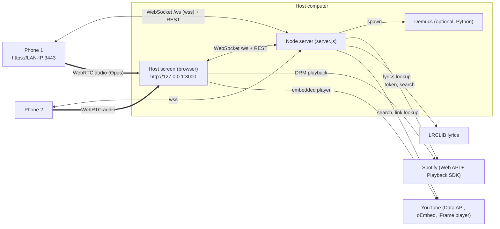

# 01 — Architecture

Status: Implemented

## Processes and ports



| Listener | Default | Env var | Who uses it | Why |
|---|---|---|---|---|
| HTTP | `3000` | `HTTP_PORT` | Host screen | Loopback http is a secure context **and** an allowed Spotify redirect URI (`http://127.0.0.1:3000/spotify/callback`). |
| HTTPS | `3443` | `HTTPS_PORT` | Phones | Browsers only expose the microphone on secure origins. A self-signed cert (SAN = all LAN IPv4s + localhost) is generated into `.data/certs/` and regenerated when IPs change. |

Both listeners serve the same Express app and the same WebSocket endpoint `/ws`.

**Host-only routes** (`hostOnly` middleware) accept requests only from loopback addresses: Spotify config/login/logout/token, vocal-range writes. Phones can search Spotify (server proxies with the host's token) but never receive the token.

## Components

| File | Runs in | Responsibility |
|---|---|---|
| `server.js` | Node 20+ | Static files, library scan, media streaming (range requests), Demucs jobs, lyrics proxy, Spotify OAuth (PKCE) + search + karaoke finder, party state, WebSocket relay/signalling. |
| `public/host.html`, `host.js` | Host browser | Playback (local `<audio>` / Spotify SDK), audio graph and mixer, WebRTC receiver, lyrics renderer, pitch lane, scoring, reports, loop/speed, key suggestions. |
| `public/mic.html`, `mic.js` | Phone | Mic capture, WebRTC sender, queueing, transport controls, lyric display, report display. |
| `public/practice.js` | Phone | Local pitch engine, tuner, drills, progress history. |
| `public/youtube.js` | Server, host, phone, Node tests | Pure YouTube helpers: link/ID parsing, durations, title → artist/title, mapping. See [08](08-youtube.md). |
| `public/training.js` | Host, phone, Node tests | Pure functions: note maths, scoring credit, steadiness, report builder, key suggestion, drill scoring. |
| `public/dsp-worklet.js` | AudioWorklet | `music-dsp` and `voice-dsp` processors wrapping the WASM. |
| `public/dsp.wasm` | AudioWorklet | Built from `dsp/` (Rust, `no_std`). See [03](03-dsp.md). |

## Host audio graph

```
musicEl ─ MediaElementSource ─┐
guideEl ─ MediaElementSource ─┼─ guide gain ─┐
                              │              ├─► music-dsp (WASM: vocal cut + key) ─► musicVol ─┐
                              └──────────────┘                                                │
guideEl source ─► voice-dsp "refYin" (pitch only) ─► gain 0 ─► destination                     │
                                                                                              ├─► master ─► limiter ─► destination
phone N: remote stream ─► MediaStreamSource ─► voice-dsp (pitch + auto-tune) ─► peer gain ─┐   │
                                                                                          ├─► micBus ─► HPF 90 Hz ─► compressor ─┬─ dry ─────────┤
                                                                                                                                 ├─ convolver ─ reverbWet ─┤
                                                                                                                                 └─ delay⟲fb ─ echoWet ───┘
```

- Spotify audio is played by the SDK's own element and **cannot** enter this graph (EME/DRM). Its volume is set with `player.setVolume`.
- YouTube audio lives in YouTube's cross-origin iframe and also can't enter the graph. Volume uses `player.setVolume`.
- Each remote stream is also attached to a muted `<audio>` element. Chrome requires this before WebAudio receives remote WebRTC audio.
- The guide (isolated vocal stem) is summed **before** `music-dsp` so key changes apply to it. Spectral cut is forced to 0 whenever stems are in use.

## State

| State | Owner | Persistence |
|---|---|---|
| Queue, now playing, connected singers (+ ranges) | Server (`state`, `clients`) | Memory only |
| Library index, stem job status | Server | Rescanned at start, stems in `.data/stems/<id>/` |
| Song vocal ranges | Server | `.data/vocal-ranges.json` |
| Spotify client ID + refresh token, YouTube API key + daily search count | Server | `.data/config.json` |
| YouTube search cache | Server | `.data/youtube-cache.json` (24 h) |
| Mixer settings | Host browser | `localStorage['karaoke-host']` |
| Singer name, range, history | Phone | `localStorage['karaoke-name' / 'karaoke-range' / 'karaoke-history']` |

Only one host screen is active: a new host connection closes the previous one with WebSocket code `4000`.

Track IDs are `sha1(relative path)[0..12]`, so they're stable across restarts as long as files aren't renamed.

## Directory layout
```
server.js            public/            dsp/ (Rust crate)      tests/            docs/specs/
music/  (user songs, git-ignored)       .data/ (generated, git-ignored: certs, config, stems, ranges)
```
